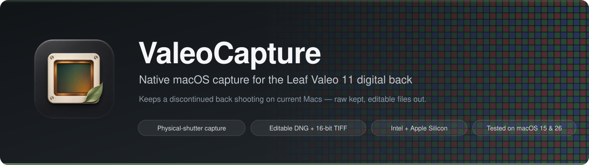
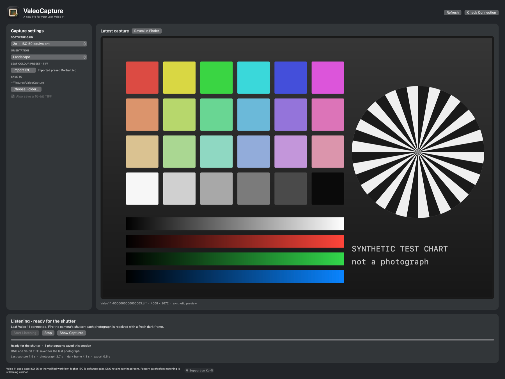

<h1 align="center">
  
</h1>

<p align="center">
  <a href="LICENSE"></a>
  
  
  
  <a href="https://ko-fi.com/oakman"></a>
</p>

<p align="center">
  <a href="#requirements">Requirements</a> ·
  <a href="#step-by-step">Step-by-step</a> ·
  <a href="#how-it-works-brief">How it works</a> ·
  <a href="#accuracy--limitations">Limitations</a> ·
  <a href="#build-and-test">Build</a> ·
  <a href="docs/PROTOCOL.md">Protocol</a>
</p>

<p align="center"><strong>© 2026 Oakman Industries — licensed CC BY-NC-SA 4.0</strong> (build on it, keep it open &amp; non-commercial; see <code>LICENSE</code>).</p>

> [!IMPORTANT]
> **ValeoCapture is still under active development and is not yet ready for a general public
> release.** Physical-shutter capture with DNG and 16-bit TIFF export works on the hardware
> listed below. Per-back calibration setup, a public preset-import workflow, a released
> macOS 26 FireWire driver with the required fixes, signing/notarization and broader
> hardware qualification are still blocking a release.
>
> If this project is useful to you and you'd like to help get it over the line, please consider
> supporting the work on **[Ko-Fi](https://ko-fi.com/oakman)** — donations go directly toward the
> hardware, testing, and research below.

> **❤️ Support more digital-back preservation work:** this is part of an ongoing effort to keep
> the Leaf Valeo 11 digital back usable on current Macs. If it's useful to you, please consider
> supporting the work on **[Ko-Fi](https://ko-fi.com/oakman)** — donations go directly toward
> hardware, testing and further research.

---

<p align="center">
  
  <br>
  <sub>The real app window, rendered with <code>ValeoCapture --render-showcase</code>. The preview shows a
  generated test chart in place of a photograph; names and timings are representative.</sub>
</p>

## At a glance

| | |
| --- | --- |
| 📷 **Capture** | Physical-shutter exposures from a Leaf Valeo 11, received over FireWire with a fresh dark frame |
| 🎞️ **Output** | Editable **4008 × 2672 DNG** with raw headroom, plus an optional **16-bit TIFF** through your own Leaf preset |
| 🔒 **Kept** | Original light and dark frames with their status records, journalled and never overwritten |
| 🎚️ **Gain** | 1× / 2× / 4× / 8× software gain (ISO 25–200 equivalent), changeable while listening |
| 💻 **Macs** | Universal app for Intel and Apple Silicon; system FireWire on macOS 10.15–15, ASFW on macOS 26 |

## Why this exists

A working digital back should stay useful after its original capture software stops running on
current computers. ValeoCapture is a small native macOS app that receives photographs from a
**Leaf Valeo 11**, keeps the original sensor data, and writes files you can develop in a current
raw editor.

The scope is deliberately narrow: the Valeo 11, the camera's physical shutter, software gain,
orientation and the back's colour presets. There is no catalog or photo editor to manage.

> **Status:** community preservation/interoperability tool for a long-discontinued digital back.
> **No Leaf firmware, software, ICC presets or per-device calibration is included or required
> from this repository** — owners supply their own resources locally.

## Requirements

- Your own Valeo 11 with power, a FireWire connection and the camera's sync connection. The tested
  body is a **Hasselblad 501CM** using the lens-to-back sync cable; the app does not fire a
  mechanical shutter.
- **Calibration data matched to your back** and **your own compatible Leaf ICC presets**. These are
  owner-supplied and excluded from this repository (see *Accuracy & limitations*).
- A Mac, in one of these configurations:

| Configuration | FireWire route | Evidence |
| --- | --- | --- |
| Intel Mac, macOS 15.7.9 | macOS's own FireWire stack (no extra driver) | Physical captures; DNGs edited in Lightroom and Capture One |
| Apple Silicon (M1 Pro), macOS 26.7.1 | [ASFW / ASFireWire](https://github.com/mrmidi/ASFireWire) DriverKit driver with fixes not yet released | Repeated physical captures, DNG + TIFF export |
| Intel macOS 10.15.7–14, Apple Silicon macOS 11–15 | macOS's own FireWire stack | Universal build targets; not yet hardware-tested |
| Intel Mac, macOS 26 | ASFW | Expected to use the same route as Apple Silicon; untested |

The app, its capture service and `valeoctl` are universal (Intel + Apple Silicon). The FireWire
route is chosen by macOS version, not by processor. A successful build for an architecture is not
proof of hardware support.

**macOS 26 and later** no longer include Apple's FireWire stack. ValeoCapture then uses the SCSI
device published by ASFW. The Valeo 11 needs several ASFW fixes (no-data commands, data-in
buffering, REPORT LUNS, SBP-2 unit-directory keys and login validation) that are being prepared
for submission to the ASFW project and are **not in a released ASFW build**. Until they are, macOS 26 use requires a
development build of ASFW, which in turn requires disabling System Integrity Protection — not
something to do casually, and not recommended for general users.

## Step-by-step

### Step 1 — Prepare your resources
Use calibration for your exact back and compatible ICC presets you already own. A distributable
import/setup flow is not finished yet; see *Build and test* for the current owner-supplied build.

### Step 2 — Build and install
Build the app (see *Build and test*) and copy `ValeoCapture.app` to **Applications**. Development
builds are ad-hoc signed; public signing and notarization are not done yet. Do not disable
Gatekeeper to run it — use macOS's normal per-app approval.

### Step 3 — Connect and check the back
Close any other camera software. Connect and power the back, open ValeoCapture and press
**Check Connection**. The app accepts only an exact Valeo 11 identity whose serial matches your
calibration.

### Step 4 — Choose settings
Choose the capture folder, orientation and Leaf preset, and the **software gain**: 1×, 2×, 4× or
8× (equivalent to ISO 25, 50, 100 and 200). On this back the higher ISO settings are digital
amplification of the base ISO 25 signal; the app neither changes analogue sensor gain nor adds
noise. Gain can be changed while listening and applies to the next image.

### Step 5 — Capture
Press **Start Listening**, wait for **Ready for the shutter**, then fire the camera's shutter. The
app receives the photograph and a fresh dark frame, then exports while the back re-arms.

### Step 6 — Develop
The **DNG** keeps the corrected, unamplified mosaic and highlight headroom and records the gain as
exposure metadata. The optional **16-bit TIFF** applies the gain and your selected Leaf preset and
embeds the actual output sRGB profile. Use **Reveal in Finder** to find the files.

### Step 7 — Stop
Press **Stop** and wait for the stopped state before disconnecting; an in-flight image and its
export finish first. Files are never overwritten.

Lightroom and Capture One are used here as file-based workflows; tethering from inside those
applications is not implemented.

## How it works (brief)

An AppKit interface talks to a per-user XPC capture service. One dedicated thread owns the camera
transport for the whole session; commands are restricted to a reviewed allowlist for the
identified model and firmware, and any FireWire bus reset ends the session.

Each exposure keeps the original light frame and a fresh auxiliary (dark) frame with their status
records, written with durable journals and published without overwriting. A separate worker
subtracts the dark frame, normalises the sensor geometry and writes a **4008 × 2672 DNG** plus an
optional RGB16 TIFF rendered through the chosen ICC preset as a real colour transform.

The wire format the back speaks — six-byte vendor CDBs over SBP-2 — is summarised in
[docs/PROTOCOL.md](docs/PROTOCOL.md).

## Accuracy & limitations

- **Calibration is per back and owner-supplied.** This repository cannot yet generate it for you;
  a public calibration setup flow is a release blocker.
- Dark-frame correction works. **Exact factory gain/defect correction and full colour fidelity are
  still being verified** — keep the original raw planes that are saved with every capture.
- Software gain was confirmed as digital amplification for the Valeo 11 only; other Leaf models
  have not been qualified.
- Sustained sessions, disconnect/reset/sleep recovery and disk-full handling need broader
  hardware testing.
- macOS 26 depends on ASFW fixes that are not yet released (see *Requirements*).
- The app does not update firmware, write persistent camera calibration, or change security
  settings. There is no software shutter for the tested 501CM setup.

## Build and test

A macOS development host with the Xcode command-line tools, CMake and Ninja. The first build
downloads a checksum-pinned codec dependency; no vendor software is fetched.

```sh
cmake -S . -B build -G Ninja -DCMAKE_BUILD_TYPE=Debug
cmake --build build
ctest --test-dir build --output-on-failure
scripts/build-app.sh
```

The default app build keeps camera commands disabled. A functional build needs your own resources:

```sh
scripts/build-app.sh --enable-capture \
  --leaf-profiles /absolute/path/to/your/presets \
  --leaf-calibration /absolute/path/to/your/calibration.json
```

Tests use synthetic fixtures only; they need no camera and no private data. More detail is in
[docs/BUILD.md](docs/BUILD.md) and [docs/INSTALL.md](docs/INSTALL.md).

## Contributing
See **[CONTRIBUTING.md](CONTRIBUTING.md)**. Contributions are released under the same
**CC BY-NC-SA 4.0** license; keep your findings open and non-commercial, and never submit
Leaf firmware/software, ICC presets or proprietary data.

## Legal / ethical
By **Oakman Industries**, for owners preserving their **own** discontinued hardware. This project
contains **no Leaf firmware, software, ICC presets or proprietary data**; all such inputs are
supplied by the owner. It interoperates with the back's protocol for preservation of long-abandoned
hardware. Separately licensed third-party material keeps its own terms; see [NOTICE](NOTICE).

## Support
❤️ **Support the project:** [ko-fi.com/oakman](https://ko-fi.com/oakman)

Contributions fund the hardware, test units, adapters, media and time that keep this and related
digital-back preservation work going.

## License
**CC BY-NC-SA 4.0** — Copyright © 2026 **Oakman Industries**. You may use, study, modify and build
on this work (code *and* the research/findings it embodies), but you must: **credit Oakman
Industries**, **release your derivatives and your own findings openly under the same license**, and
**not use it commercially**. Full text in `LICENSE`. (Deliberately copyleft + non-commercial, so
improvements stay open to the community. Note: because of the NonCommercial clause this is
intentionally not an OSI "open source" license.)

## Provenance / fingerprint
Every DNG and TIFF ValeoCapture writes carries an **invisible, non-destructive Oakman Industries
provenance mark**: one extra metadata entry (`DNGPrivateData`, tag 50740) naming
`oakman-industries/ValeoCapture`. It never changes a parsed value, an image pixel or a raw sample,
and readers that do not know the tag ignore it. Check any output with:

```sh
valeoctl fingerprint-check /path/to/file.dng
```
